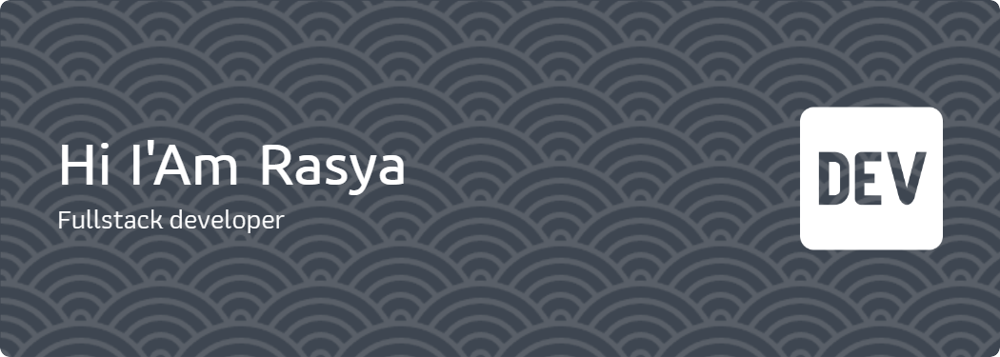

  

<h1 align="center">Rasya Putra Pratama</h1>

  <strong>Full-Stack Developer · Junior Game Developer</strong> 
  Batang, Central Java, Indonesia

  <em>Open for Internship, Freelance, and Remote roles · Focused on ML/AI Engineering and Robotics for the future</em>

  
  
  
  
  
  
  

 

## About

Undergraduate student at **Universitas Teknologi Yogyakarta (UTY)** building web platforms, system tools, and game prototypes. Currently developing full-stack architectures and machine learning forecasting services, with long-term focus toward ML/AI engineering and robotics. Outside of programming, I enjoy studying new technical patterns, experimenting with game mechanics, and eating mie ayam.

## Featured Projects

| Project | Description | Tech Stack | Status |
|---|---|---|---|
| [PasokanMataram](https://github.com/SyaPratama/PasokanMataram) | B2B agri-supply platform connecting farmer groups (Gapoktan) with HoReCa buyers. Built with escrow settlement and price forecasting. | Next.js, NestJS, TypeScript, PostgreSQL RLS, Redis | [Live Demo](https://pasok.syapratama.tech) |
| [MLPasokanMataram](https://github.com/SyaPratama/MLPasokanMataram) | Microservice delivering food price forecasting and BMKG weather risk inference. | Python, FastAPI, LightGBM, MLflow, Docker | Active |
| [9router-rust](https://github.com/SyaPratama/9router-rust) | Low-latency AI request router with automatic provider fallback across 40+ endpoints. | Rust, Docker | Active |
| FindMoney | Atmospheric narrative horror game exploring custom lighting and sound cues. | Godot Engine, GDScript | Private |
| ViCore | Story-driven simulation game built around branching narrative paths and choices. | C# | Private |

## Stack

- **Languages:** TypeScript, JavaScript, Python, Rust, C#, GDScript, PHP
- **Frontend:** Next.js, React, Tailwind CSS, Blade, HTML5, CSS3
- **Backend:** NestJS, Node.js, FastAPI, Express
- **Databases & Cache:** PostgreSQL, Redis, MySQL
- **DevOps & Tools:** Docker, Git, GitHub Actions, Vercel, Linux, VS Code, Figma, Postman, npm
- **Game & Creative:** Godot Engine, Canvas API, Blender

  

## Stats

  

## Contributions

  

## Development Activity

  

<strong>Project and portfolio insights</strong>

### PasokanMataram

  

### Portfolio performance

  

## Contact

I am open to internship positions, freelance development, and remote software engineering opportunities.

- **Email:** [inirasya16@gmail.com](mailto:inirasya16@gmail.com)
- **LinkedIn:** [rasya-putra-pratama](https://www.linkedin.com/in/rasya-putra-pratama-826497329)
- **Portfolio:** [syapratama.vercel.app](https://syapratama.vercel.app)
