<h1 align="center">
  
</h1>

<h3 align="center">Full-stack web developer and junior game developer based in Batang, Central Java, Indonesia. I like picking up new tools and shipping things that hold up.</h3>

 

🎓 Student at **Universitas Teknologi Yogyakarta (UTY)**

🧪 Mostly writing TypeScript, Python and Rust lately

🍜 Fun fact **I could eat mie ayam every day**

 

  
  
  
  
  
  
  
  
  

<h2 align="center">Featured work</h2>

- **[PasokanMataram](https://github.com/SyaPratama/PasokanMataram)** — B2B SaaS for collective food procurement, linking farmer groups (Gapoktan) with HoReCa buyers in Yogyakarta. Next.js monorepo, strict TypeScript, NestJS, PostgreSQL RLS, escrow settlement, ML price forecasting. Live at [pasok.syapratama.tech](https://pasok.syapratama.tech).
- **[MLPasokanMataram](https://github.com/SyaPratama/MLPasokanMataram)** — multi-horizon food price forecasting and BMKG weather risk inference. FastAPI, LightGBM, MLflow, Docker.
- **[9router-rust](https://github.com/SyaPratama/9router-rust)** — low-latency AI request router in Rust across 40+ providers, with provider fallback and a Docker image.

<h2 align="center">Stack</h2>

  

<h2 align="center">Stats</h2>

  

Rendered daily by <a href="https://github.com/lowlighter/metrics">lowlighter/metrics</a> — see <a href=".github/workflows/metrics.yml">the workflow</a>.

<h2 align="center">Contributions</h2>

<picture>
  <source media="(prefers-color-scheme: dark)" srcset="https://raw.githubusercontent.com/SyaPratama/SyaPratama/output/pacman-contribution-graph-dark.svg">
  <source media="(prefers-color-scheme: light)" srcset="https://raw.githubusercontent.com/SyaPratama/SyaPratama/output/pacman-contribution-graph.svg">
  
</picture>

<h1 align="center">
  
</h1>

<h1 align="center">
  
</h1>
